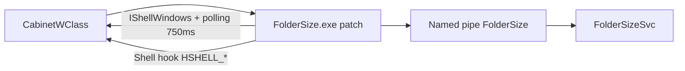

# Folder Size — correção para Windows 11 (popups no Explorer)

Reimplementação do cliente **`FolderSize.exe`** do [Folder Size for Windows 2.6](https://sourceforge.net/projects/foldersize/) (GPLv2, Brian Oraas / `brio1337`). O serviço `FolderSizeSvc`, o painel `FolderSize.cpl` e a coluna para XP **não** são alterados — só o executável da bandeja/popups.

## Sobre o projeto original

| Item | Detalhe |
|------|---------|
| Licença | [GPLv2](LICENSE) |
| Última release oficial | 2.6 (2013) |
| Fonte publicada | Apenas [FolderSize-2.0-src.zip](https://sourceforge.net/projects/foldersize/files/foldersize/2.0/) — **não** há fonte da 2.6 no SourceForge |
| Modo Vista+ | `FolderSize.exe` abre popups `FolderSizeShellWindow` ao lado do Explorer |

No Windows 11 o modo coluna do Explorer (XP) não existe; o fluxo é **serviço + cliente popup**.

## O bug

**Sintoma:** ao abrir uma **segunda** (ou terceira) janela do Explorer (`Win+E`), o popup de tamanhos **não aparece** ou não acompanha — só a primeira janela costuma funcionar.

**Causa (cliente 2.6):** o rastreio depende principalmente de `DShellWindowsEvents` (`WindowRegistered` / `WindowRevoked`) e de associação frágil entre janelas novas e popups. No Win11 isso fica incompleto.

**Causa extra encontrada neste patch:** ao enumerar janelas via `IShellWindows`, `IShellBrowser::GetWindow` devolve um HWND **interno** do controlador web, **não** o topo `CabinetWClass`. Todos os explorers eram descartados no filtro. A correção usa `IWebBrowser2::get_HWND` + `GetAncestor(..., GA_ROOT)` para obter o frame correto.

Relacionado (upstream, ainda aberto): [bug #35](https://sourceforge.net/p/foldersize/bugs/35/) — popup não volta após fechar.

## O que este repositório faz



- **Polling** (~750 ms) de instâncias `IShellWindows` / `_NewEnum`
- **`RegisterShellHookWindow`** para `HSHELL_WINDOWCREATED`, `DESTROYED`, `ACTIVATED`
- Um popup **`FolderSizeShellWindow` por HWND** do Explorer
- Listagem da pasta atual via `\\.\pipe\FolderSize` (protocolo compatível com o serviço 2.6)
- Pastas virtuais (ex.: **Início**) mostram aviso; pastas em disco listam tamanhos do cache do serviço

Código do patch: [`client/src/`](client/src/)  
Referência do upstream 2.0 (GPL): [`upstream-2.0/`](upstream-2.0/)  
Binários extraídos da MSI 2.6 (somente referência): [`reference/`](reference/)

## Instalação

1. Instale o **Folder Size 2.6 x64** oficial ([MSI no SourceForge](https://sourceforge.net/projects/foldersize/files/foldersize/2.6/)).
2. Confirme o serviço **FolderSize** em execução (`services.msc`).
3. Feche o cliente na bandeja (*Exit*).
4. Substitua o executável:

   ```
   C:\Program Files\FolderSize\FolderSize.exe
   ```

   pelo build deste repo (`dist/FolderSize.exe` ou [GitHub Releases](https://github.com/alanspindler/foldersize-win11-fix/releases), quando publicado).

5. Inicie de novo pelo Menu Iniciar **sem** “Executar como administrador” (processo elevado não enxerga o Explorer do usuário).

## Compilar

Requisitos: **Visual Studio 2022 Build Tools** (C++), **CMake**, **Ninja**.

```bat
"C:\Program Files (x86)\Microsoft Visual Studio\2022\BuildTools\VC\Auxiliary\Build\vcvars64.bat"
cd foldersize-win11-fix
cmake -B build -G Ninja -DCMAKE_BUILD_TYPE=Release
cmake --build build
```

Saída: `build/FolderSize.exe` (versão de recurso **2.6.1.0**).

## Teste rápido (Windows 11)

1. Bandeja → *Show Folder Size popups* marcado.
2. `Win+E` → um popup ao lado.
3. `Win+E` de novo → **segundo** popup.
4. Feche uma janela do Explorer → popup some.
5. Navegue para `C:\` ou Downloads → tamanhos de subpastas (via serviço).

## Licença e atribuição

Este trabalho é um **derivado** do Folder Size for Windows (**GPLv2**). O código novo neste repositório é distribuído sob a mesma licença — veja [LICENSE](LICENSE). Melhorias devem permanecer livres conforme a GPL.

O projeto original não é mantido desde 2013; este repositório **não** é afiliado ao autor Brian Oraas — é um patch comunitário para Windows 11.

**Não confundir** com o produto comercial [MindGems “Folder Size” 5.x](https://www.mindgems.com/products/Folder-Size/) (outro software).
